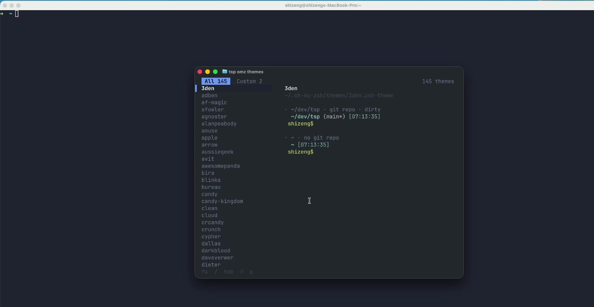

# tsp (Terminal Settings Preview)

[English](README.md) | 简体中文

[](https://github.com/shizengzhou/tsp/actions/workflows/release.yml)

[](https://youtu.be/sA8lwbAzxVU)

终端配置的预览小工具集合：

- `tsp omz themes` — oh-my-zsh 主题浏览器，右侧实时预览提示符；回车通过 `omz theme set` 应用主题
- `tsp omp themes` — oh-my-posh 主题浏览器，右侧实时预览提示符；回车改写 shell profile 中的 `oh-my-posh init` 行
- `tsp fonts` — 已安装等宽字体家族浏览器，右侧显示样式与字形示例；回车把所选家族名输出到 stdout
- `tsp themes` — alacritty 配色主题浏览器，右侧预览调色板与代码；回车通过 `general.import` 应用主题

## 环境要求

- Go 1.27.3+（从源码构建）
- `tsp omz themes`：`zsh` 与 oh-my-zsh（默认读取 `~/.oh-my-zsh`）
- `tsp omp themes`：`oh-my-posh` 在 `PATH` 中（主题来自 `$POSH_THEMES_PATH` 与安装器目录，含 Microsoft Store 包）
- `tsp fonts`：除二进制外无额外依赖

## 安装

### 安装脚本

```bash
curl -fsSL https://raw.githubusercontent.com/shizengzhou/tsp/main/install.sh | bash
```

脚本会自动识别 macOS/Linux 与 amd64/arm64，校验 `checksums.txt`，并把 `tsp` 安装到 `~/.local/bin`。指定版本或安装位置：

```bash
curl -fsSL https://raw.githubusercontent.com/shizengzhou/tsp/main/install.sh \
  | bash -s -- --version v0.1.0 --dir /usr/local/bin
```

### Windows（PowerShell）

```powershell
irm https://raw.githubusercontent.com/shizengzhou/tsp/main/install.ps1 | iex
```

指定版本或安装位置：

```powershell
irm https://raw.githubusercontent.com/shizengzhou/tsp/main/install.ps1 -OutFile install.ps1
.\install.ps1 -Version v0.1.0 -InstallDir C:\Tools
```

脚本会下载 Windows zip 包、校验 `checksums.txt`，并把 `tsp.exe` 安装到 `%USERPROFILE%\.local\bin`。支持 Windows PowerShell 5.1+ 与 PowerShell 7。

> `tsp` 仍然需要 `PATH` 中有 `zsh` 与 oh-my-zsh（例如通过 MSYS2 安装）。使用 WSL 时，请直接在 WSL 内用 `install.sh` 安装 Linux 版本。

### 手动下载

每个 [release](https://github.com/shizengzhou/tsp/releases) 都会附带 macOS 与 Linux（tar.gz）和 Windows（zip）的预编译包，解压后把 `tsp`（或 `tsp.exe`）放到 `PATH` 即可。

### 从源码构建

```bash
go build -o tsp .
# 或安装到 $GOBIN
go install .
```

Windows 上要保留 `.exe` 后缀，否则 PowerShell/CMD 无法执行该文件：

```powershell
go build -o tsp.exe .
# 或安装到 %GOBIN%
go install .
```

## 使用

### 终端配色主题（alacritty）

```bash
tsp themes
```

浏览 alacritty 配置目录下的配色主题（`~/.config/alacritty/themes`，或 `$ALACRITTY_CONFIG_DIRECTORY/themes`）。该命令必须在 alacritty 内运行，因为在其他终端里看不到所选配色的效果，非 alacritty 终端会直接报错退出。首次运行且该目录不存在时，会先从 [iTerm2-Color-Schemes](https://github.com/mbadolato/iTerm2-Color-Schemes) 下载 alacritty 版本的主题到该目录。左侧是主题列表，右侧用主题自身的颜色预览调色板、前景/背景色和一段示例终端输出。

`Enter` 会让 alacritty 使用该主题：把 `alacritty.toml` 的 `general.import` 指向主题文件，并注释掉内联的 `[colors*]` 表（alacritty 最后加载主配置文件，不注释的话内联颜色会覆盖导入的主题）。配置会保留 `.bck` 备份，alacritty 自动重载生效。YAML 配置不受支持，需先转换为 TOML。

| 参数 | 说明 | 默认值 |
| --- | --- | --- |
| `--themes DIR` | 主题目录 | `<alacritty 配置目录>/themes` |
| `--config FILE` | 要修改的 alacritty 配置文件 | 配置目录下的 `alacritty.toml` |

按键：`↑`/`↓`、`j`/`k`、`PgUp`/`PgDn`、`g`/`G`，直接输入或 `/` 过滤，`Enter` 应用，`Esc` 清空过滤，`q` 退出。

### 版本与更新

```bash
tsp version
tsp update
```

`tsp version` 打印构建版本（本地构建为 `dev`，发布包为对应的 tag）。`tsp update` 会检查 GitHub 最新 release，按当前系统/架构下载对应压缩包，用 release 的校验和验证后原地替换当前二进制。若 tsp 所在目录不可写，可用 `sudo tsp update`，或重新运行安装脚本。`TSP_BASE_URL`、`TSP_API_URL` 可覆盖下载与 API 地址，与安装脚本一致。

### 主题

```bash
tsp omz themes
```

指定安装路径与自定义主题目录：

```bash
tsp omz themes --zsh ~/.oh-my-zsh --custom ~/.config/zsh/custom
```

### 参数

| 参数 | 说明 | 默认值 |
| --- | --- | --- |
| `--zsh DIR` | oh-my-zsh 安装目录 | `$ZSH`，否则 `~/.oh-my-zsh` |
| `--custom DIR` | 自定义主题目录 | `$ZSH_CUSTOM`，否则 `<zsh>/custom` |

主题来源为 `<zsh>/themes/*.zsh-theme` 与自定义目录下的 `*.zsh-theme`（根目录及子目录）。同名主题以自定义目录为准。

### 快捷键

| 按键 | 动作 |
| --- | --- |
| `↑` / `↓`、`j` / `k` | 移动选择 |
| `PgUp` / `PgDn` | 翻页 |
| `g` / `G`、`Home` / `End` | 跳到首尾 |
| 直接输入 或 `/` | 按名称过滤（大小写不敏感） |
| `Esc` | 清空过滤（并退出输入状态） |
| `Tab`、`1` / `2`、`←` / `→` | 切换 All / Custom |
| `Enter` | 调用 `omz theme set` 应用当前主题 |
| `r` | 清除预览缓存并重新渲染 |
| `q`、`Ctrl+C` | 退出 |

`Enter` 会改写 `~/.zshrc` 中的 `ZSH_THEME` 行，并生成 `.zshrc.bck` 备份；需要重新打开 zsh（或 `source ~/.zshrc`）后生效。

### oh-my-posh 主题

```bash
tsp omp themes
```

指定主题目录或其它 shell：

```bash
tsp omp themes --themes ~/.config/oh-my-posh/themes --shell zsh
```

### 参数

| 参数 | 说明 | 默认值 |
| --- | --- | --- |
| `--themes DIR` | 主题目录 | `$POSH_THEMES_PATH`、安装器目录与 Microsoft Store 包 |
| `--shell NAME` | 预览并写入配置的 shell | Windows 为 `pwsh`，其余为 `zsh` |

主题来自主题目录下的 `*.omp.json` 与 `*.json`。内嵌在 oh-my-posh 二进制里的 Store 版主题只按名字列出、也按名字引用，这样升级 oh-my-posh 后 profile 仍然有效。

预览由真实的 `oh-my-posh print` 渲染：使用临时 home 与一个带未提交改动的 git 仓库，因此会同时展示「仓库」和「普通目录」两种场景。预览按主题名与宽度缓存，选中时渲染，最多 3 个 oh-my-posh 进程并发，单次渲染超时 5 秒。

### 快捷键

| 按键 | 动作 |
| --- | --- |
| `↑` / `↓`、`j` / `k` | 移动选择 |
| `PgUp` / `PgDn` | 翻页 |
| `g` / `G`、`Home` / `End` | 跳到首尾 |
| 直接输入 或 `/` | 按名称过滤（大小写不敏感） |
| `Esc` | 清空过滤（并退出输入状态） |
| `Enter` | 把当前主题写入 shell profile |
| `r` | 清除预览缓存并重新渲染 |
| `q`、`Ctrl+C` | 退出 |

`Enter` 会改写 profile 中的 `oh-my-posh init` 行（插入或替换 `--config <主题>`），并生成 `<profile>.bck` 备份；需要重新打开 shell 后生效。

### 字体

```bash
tsp fonts
```

左侧列出所有能解析的已安装等宽字体家族，比例字体会被跳过：

- macOS：`~/Library/Fonts`、`/Library/Fonts`、`/System/Library/Fonts` 及其 `Supplemental` 目录
- Linux：`~/.fonts`、`~/.local/share/fonts`、`/usr/local/share/fonts`、`/usr/share/fonts`
- Windows：`%WINDIR%\Fonts`、`%LOCALAPPDATA%\Microsoft\Windows\Fonts`

右侧显示家族名、样式、带 ASCII 字形示例（与 kitty `choose-fonts` 相同，按面板宽度自动换成多行）的 `preview` 区块，以及 PostScript 名和源文件。所选字体缺失的字符会被略去；ASCII 覆盖不足或没有可缩放轮廓的字体会退回文本示例。`Enter` 会把选中的家族名打印到 stdout，方便脚本读取：

```bash
font="$(tsp fonts)"
```

在能响应图形能力查询的终端中——Kitty graphics 协议（kitty、Ghostty、WezTerm 以及其他基于 libghostty 的终端）或 iTerm2 inline image 协议（iTerm2、开启 `terminal.integrated.enableImages` 的 VS Code）——示例会用所选字体栅格化成图片并贴到右侧，是真实预览。启动浏览器前会直接向终端查询能力；对不响应查询的终端（部分 VS Code 系终端只实现了 inline image 而不响应查询）再用环境变量兜底。图片背景透明，字形颜色会根据终端上报的背景色（无法获取时回退 `COLORFGBG`）自动选择深色或浅色，因此在明/暗主题下都清晰可读，也不会出现色块。其他终端与 tmux 会退回用终端当前字体绘制的文本示例，并在界面中说明。Windows 上，控制台程序的输出要经过 ConPTY，而 ConPTY 通常会丢弃图形转义序列，因此只有自带 ConPTY 并会转发这些序列的终端才能显示图片预览（Otty 可以；尚未处理 ConPTY 的旧版 WezTerm 会退回文本示例）。对这类终端可用 `TSP_GRAPHICS=1` 强制启用图形。`TSP_GRAPHICS=0` 可强制文本回退。

| 按键 | 动作 |
| --- | --- |
| `↑` / `↓`、`j` / `k` | 移动选择 |
| `PgUp` / `PgDn` | 翻页 |
| `g` / `G`、`Home` / `End` | 跳到首尾 |
| 直接输入 或 `/` | 按家族名过滤 |
| `Esc` | 清空过滤（并退出输入状态） |
| `Enter` | 输出家族名并退出 |
| `q`、`Ctrl+C` | 退出 |

## 主题预览是怎么生成的

预览不是静态示例，而是用真实 zsh 渲染出来的：

1. 非交互启动 `zsh -f`，加载 oh-my-zsh 的 `lib/git.zsh`、`lib/prompt_info_functions.zsh`、`lib/theme-and-appearance.zsh`
2. 关闭 oh-my-zsh 的异步 git 提示，保证提示符里的分支/脏状态同步可得
3. `source` 目标主题文件，然后以 `print -P` 展开 `PROMPT` / `RPROMPT`
4. 在临时 `HOME` 下准备一个带未提交改动的 `~/dev/tsp` git 仓库，分别渲染「git 仓库 · dirty」与「非 git 目录」两种场景
5. 把预览栏宽度通过 `COLUMNS` 传给 zsh，使 `af-magic` 这类按列宽绘制分隔线的主题与实际宽度一致

渲染结果按「主题 + 宽度」缓存；选中主题时才渲染，最多并发 3 个 zsh 进程，单次超时 6 秒。

## 其它行为

- 所有浏览器都必须在交互式终端中运行；输出被管道接走时会报错
- `tsp themes` 必须运行在 alacritty 内（通过 `ALACRITTY_SOCKET`/`ALACRITTY_WINDOW_ID`、`TERM_PROGRAM=Alacritty` 或 `TERM` 以 `alacritty` 开头识别；Windows 上 ConPTY 会改写 `TERM`，因此改为检查父进程链中是否有 `alacritty.exe`），否则直接报错退出
- `tsp themes` 只解析 alacritty 的 TOML 配色文件；`.yml` 配置会被拒绝并提示先迁移到 TOML
- 首次运行 `tsp themes` 需要联网获取并下载 alacritty 主题；下载失败时不会留下 themes 目录
- `tsp omz themes` 在未安装 oh-my-zsh（或 `<zsh>/themes` 为空）时报错并以退出码 1 结束，可用 `--zsh` 指定实际路径
- `tsp omp themes` 在 `oh-my-posh` 不在 `PATH`、或找不到任何主题时报错并以退出码 1 结束，可用 `--themes` 指定实际目录
- 自定义目录不存在不影响使用，只是 Custom 页为空
- 主题预览是静态快照：依赖外部工具或运行时的内容（virtualenv、kube 上下文、时间等）可能显示为空或旧值，按 `r` 可重新渲染
- 设置主题只改写 `.zshrc` 或 shell profile，不会影响当前已经打开的 shell
- `tsp fonts` 用 `q` 退出时不会输出任何内容；只有 `Enter` 会打印家族名
- 字体示例使用 `golang.org/x/image` 栅格化，不会应用连字、样式集等 OpenType 特性

## 发布

推送版本 tag 后，[release workflow](.github/workflows/release.yml) 会运行测试、构建 macOS/Linux/Windows（amd64/arm64）压缩包，并附带校验和发布：

```bash
git tag v0.1.0
git push origin v0.1.0
```

## 目录结构

```
main.go                 命令分发与帮助
install.sh              macOS/Linux 安装脚本
install.ps1             Windows 安装脚本
internal/update/update.go 从 GitHub release 自更新
internal/omz/theme.go   主题发现（$ZSH/themes + $ZSH_CUSTOM）
internal/omz/preview.go 主题预览渲染器、临时 HOME、结果缓存
internal/omz/ui.go      主题浏览器界面
internal/omz/set.go     调用 omz theme set 应用主题
internal/omz/run.go     主题入口与终端检查
internal/alacritty/theme.go 主题发现与 TOML 颜色解析
internal/alacritty/download.go 首次运行从 iTerm2-Color-Schemes 下载
internal/alacritty/set.go 写入 general.import 并注释内联颜色
internal/alacritty/ui.go 配色主题浏览器界面
internal/alacritty/run.go 主题入口、首次运行准备
internal/omp/theme.go   oh-my-posh 主题发现（含 Store 包目录）
internal/omp/preview.go oh-my-posh 主题预览渲染器、临时 HOME、结果缓存
internal/omp/ui.go      oh-my-posh 主题浏览器界面
internal/omp/set.go     改写 shell profile 中的 init 行
internal/omp/run.go     oh-my-posh 主题入口与终端检查
internal/fonts/font.go  已安装字体发现与家族分组
internal/fonts/ui.go    字体浏览器界面
internal/fonts/image.go 将字体示例栅格化为 PNG
internal/fonts/probe.go 向终端查询其支持的图形协议
internal/fonts/graphics.go 图形协议选择与图像转义序列
internal/fonts/run.go   字体入口与终端检查
```
